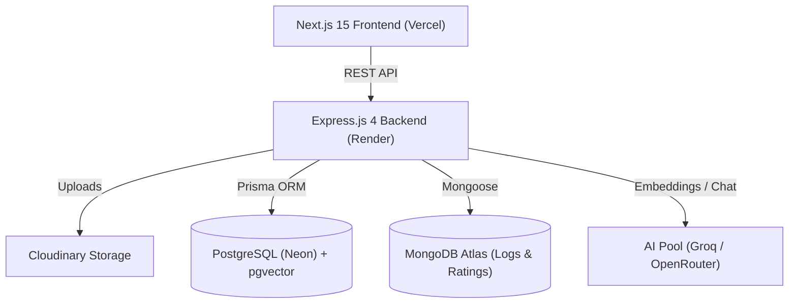
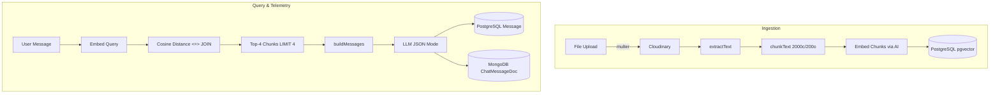
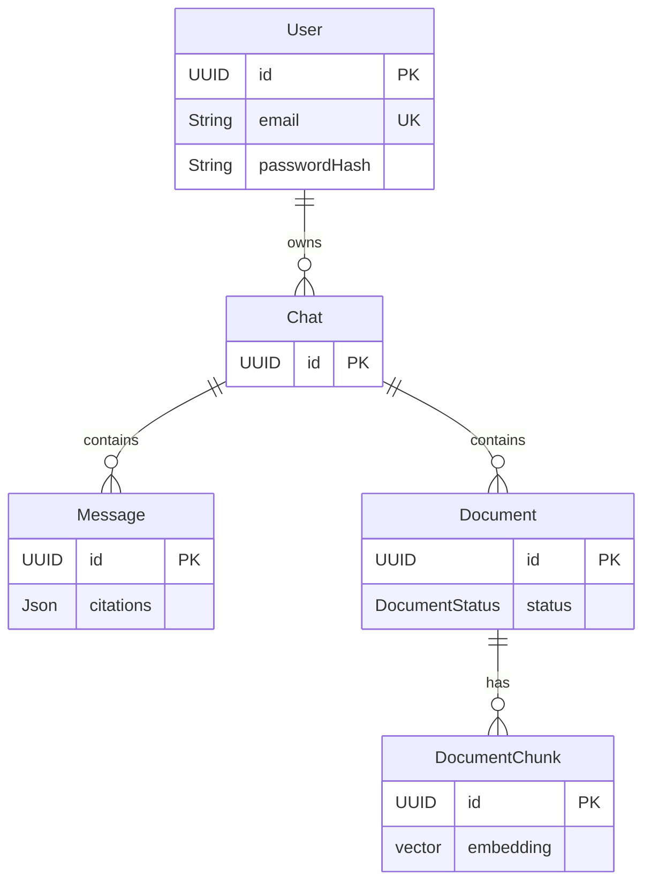

# rag99

> Retrieve first. Generate second. Trust evidence over confidence.

## 1. Project Overview
**rag99** is a production-grade full-stack Retrieval-Augmented Generation (RAG) application. It empowers users to upload documents (PDF, DOCX, TXT, MD), ask questions, and receive hallucination-free answers strictly grounded in the uploaded evidence. The system features a **Polyglot Persistence Architecture** combining PostgreSQL with `pgvector` for transactional data and vector similarity search, alongside MongoDB for semi-structured conversation analytics, user feedback ratings, and end-to-end pipeline latency telemetry.

## 2. Problem Statement
Large Language Models hallucinate when answering questions outside their training data or when specific organizational knowledge is required. rag99 solves this by injecting domain-specific context into the LLM's prompt using vector search, ensuring answers are reliable, accurate, verifiable via citations, and monitored with audit logging.

## 3. Core Features
- **Document Ingestion:** Upload PDF, DOCX, TXT, or MD files. Files are parsed using `pdf-parse`, `mammoth`, and UTF-8 decoders, uploaded to Cloudinary, and embedded in the background.
- **Vector Search:** Documents are chunked (2000 characters, 200 overlap), embedded via OpenRouter (`text-embedding-3-small`), and queried using exact cosine distance in PostgreSQL (`pgvector`).
- **Context-Aware Chat:** Retrieves the top-4 most relevant document chunks and passes them to the LLM (via a multi-provider round-robin pool in `client-pool.ts`) along with conversation history.
- **Evidence-Based UI:** Features `ContextCards.tsx` and `ThinkingState.tsx` to visualize RAG execution steps, live progress, and source citations.
- **Polyglot Persistence & Feedback:** Dual-engine architecture. PostgreSQL + `pgvector` handles relational entities and vector search; MongoDB logs conversational turn telemetry and persists user feedback (thumbs-up/down ratings).
- **High-Availability AI Pool:** Automatic round-robin rotation across Groq (`llama-3.3-70b-versatile`) and multiple OpenRouter API keys to prevent rate limits and downtime.

## 4. Architecture Overview



## 5. RAG Pipeline Flow



## 6. Technology Stack

| Category | Technology |
|---|---|
| **Frontend** | Next.js 15 App Router, React 19, TypeScript, Tailwind CSS 3, shadcn/ui |
| **Backend** | Express.js 4, Node.js (ES Modules), TypeScript, Multer, Mongoose |
| **Primary Relational & Vector DB** | PostgreSQL (Neon serverless), Prisma ORM, pgvector extension (1024-dim) |
| **Document & Telemetry DB** | MongoDB Atlas, Mongoose (Polyglot persistence for logs, telemetry, ratings) |
| **Authentication** | JWT (7-day expiry), bcryptjs (12 rounds), Google OAuth 2.0 |
| **AI Models** | Groq (llama-3.3-70b-versatile), OpenRouter (meta-llama/llama-3.3-70b-instruct, text-embedding-3-small) |
| **Object Storage** | Cloudinary (raw + image resource types) |
| **Deployment Targets** | **Vercel** (Frontend) + **Render** (Backend Web Service) |

## 7. API Overview

| Method | Path | Purpose | Auth Required |
|---|---|---|---|
| `GET` | `/health` | Health check | No |
| `POST` | `/api/auth/register` | Register new user | No |
| `POST` | `/api/auth/login` | Login user | No |
| `POST` | `/api/auth/google` | Google OAuth | No |
| `GET` | `/api/chats` | List all chats | Yes |
| `POST` | `/api/chats` | Create new chat | Yes |
| `GET` | `/api/chats/:chatId` | Get chat with messages/docs | Yes |
| `PATCH` | `/api/chats/:chatId` | Rename chat | Yes |
| `DELETE`| `/api/chats/:chatId` | Delete chat (cascades PG + Mongo) | Yes |
| `GET` | `/api/chats/:chatId/messages`| List messages | Yes |
| `POST` | `/api/chats/:chatId/messages`| Send RAG query | Yes |
| `PATCH` | `/api/chats/:chatId/messages/:messageId/rating` | Thumbs-up/down feedback | Yes |
| `GET` | `/api/chats/:chatId/analytics` | MongoDB Aggregation Pipeline stats | Yes |
| `GET` | `/api/chats/:chatId/documents`| List documents | Yes |
| `POST` | `/api/chats/:chatId/documents`| Upload document | Yes |
| `DELETE`| `/api/documents/:documentId`| Delete document | Yes |

## 8. Database Architecture: Polyglot Persistence

### Relational & Vector Engine (PostgreSQL + pgvector)
Managed via Prisma ORM (`api/prisma/schema.prisma`). Enforces strict ACID compliance, relational integrity with cascade deletes, and performs cosine distance vector queries (`<=>`) using PostgreSQL's `pgvector` extension.



### Document & Telemetry Engine (MongoDB Atlas)
Managed via Mongoose (`api/src/db/mongo.ts`). Stores semi-structured conversation records, user feedback ratings (`rating: "up" | "down"`), citations, and latency metrics (`embedDurationMs`, `retrievalDurationMs`, `llmDurationMs`). Includes an automatic fail-safe bypass so core application features remain 100% operational even during external connection blips.

## 9. Authentication & Security
- **Local Auth:** Utilizes `bcryptjs` for salted password hashing (12 rounds).
- **OAuth:** Google OAuth 2.0 via tokeninfo endpoint validation.
- **Tokens:** JSON Web Tokens (JWT) issued with a **7-day expiration**.
- **Rate Limiting:** In-memory map restricting requests to 60 per minute per IP.
- **Validation:** Strict runtime schema validation using `Zod`.
- **CORS:** Flexible multi-origin validation supporting local development and production Vercel domains.
- **File Uploads:** Memory-based single file upload via `multer` capped at 10MB, restricted by MIME type.

## 10. Repository Structure
```
rag99/
├── api/                  # Express.js backend
│   ├── src/
│   │   ├── ai/           # client-pool.ts, prompt-builder.ts, retrieval.ts
│   │   ├── db/           # prisma.ts, mongo.ts (Polyglot persistence)
│   │   ├── documents/    # extract-text.ts, chunk-text.ts, file-storage.ts
│   │   ├── http/         # errors.ts, async-handler.ts
│   │   ├── middleware/   # auth.ts, error.ts, rate-limit.ts
│   │   ├── routes/       # auth, chat, document
│   │   ├── services/     # auth, chat, document, message
│   │   └── app.ts, server.ts
│   └── prisma/schema.prisma
├── web/                  # Next.js 15 App Router frontend
│   ├── app/              # /login, /register, /chats, /[chatId]
│   ├── components/       # ThinkingState, ContextCards, LiquidGlass, etc.
│   └── lib/              # api.ts, types.ts
└── docs/                 # System Architecture & Design Documents
```

## 11. Local Development Setup
The project runs as an npm workspaces monorepo.
1. Clone the repository.
2. Run `npm install` from the root directory.
3. Set up environment variables in `api/.env` and `web/.env`.
4. Run `npm run dev` to start both the Express backend (`http://localhost:4000`) and the Next.js frontend (`http://localhost:3000`).

## 12. Deployment Guide Summary
- **Backend (Render):** Deploy `api` as a Node Web Service. Build command: `npm install && npx prisma generate && npm run build`. Start command: `node dist/server.js`.
- **Frontend (Vercel):** Deploy `web` as a Next.js project. Root directory: `web`. Environment variables: `NEXT_PUBLIC_API_URL` pointing to the Render backend URL.

## 13. Documentation
Detailed technical specifications and design documentation can be found in the `docs/` directory:
- [PRD.md](./docs/PRD.md) - Product Requirements Document
- [HLD.md](./docs/HLD.md) - High-Level Design
- [LLD.md](./docs/LLD.md) - Low-Level Design
- [AAD.md](./docs/AAD.md) - API & AI Architecture Document
- [BAD.md](./docs/BAD.md) - Backend Architecture Document
- [FAD.md](./docs/FAD.md) - Frontend Architecture Document


## 14. Architecture & Engineering Checklist Reference

| Concept | Layer | Implementation Evidence |
|---|---|---|
| **JavaScript — Hoisting** | Frontend & Backend | `web/components/ThinkingState.tsx` (`const STAGES` in Temporal Dead Zone vs hoisted `function useSequence`), `api/src/services/auth.service.ts` (block-scoped `let user` vs `var`) |
| **JavaScript — Event loop** | Frontend | `web/components/ThinkingState.tsx`, `web/components/EventLoopStatus.tsx`, `web/lib/event-loop.ts` (Synchronous Call Stack execution, Microtask queue resolution via `queueMicrotask` & `Promise.then`, Macrotask timer scheduling via `setTimeout`) |
| **MongoDB CRUD Operations** | NoSQL (MongoDB) | `api/src/db/mongo.ts` (`logMongoMessage` for CREATE, `getChatAnalyticsPipeline` for RETRIEVE), `api/src/routes/chat.routes.ts` (`updateOne` rating for UPDATE, `deleteMany` for DELETE) |
| **MongoDB Schema Modeling** | NoSQL (MongoDB) | `api/src/db/mongo.ts` (Embedding: `CitationSubSchema`, `RagTelemetrySubSchema`; Referencing: `ChatSessionMetaSchema.lastMessageRef` and `.populate()`) |
| **Multi-step agent** | AI App Engineering | `web/components/ThinkingState.tsx` (`VARIANTS.Steps.rows` sequential UI milestone execution), `api/src/services/message.service.ts` (embedding -> retrieval -> prompt -> synthesis) |
| **RAG — embeddings & vector retrieval** | AI App Engineering | `api/src/ai/retrieval.ts` (pgvector `<=>` cosine distance, 1024-dimension float vectors, strict `chatId` context isolation) |
| **Backend deployment** | Backend & DevOps | `api/Dockerfile` (multi-stage build on `node:20-alpine`, `EXPOSE 4000`), `render.yaml` (Render Web Service with dynamic `PORT` binding in `api/src/server.ts`) |
| **Loading & error UI states** | Frontend | `web/components/LoadingState.tsx` (`label`, `variant`, `LoaderGrid` 3x3 delay matrix, `useElapsed` timer with cleanup), `web/app/chats/[chatId]/page.tsx` (error banner fallback) |
| **Prompt injection awareness & defenses** | Security & Auth | `api/src/middleware/sanitization.ts` (`PROMPT_INJECTION_PATTERNS`, `SPECIAL_TOKENS` stripping), `api/src/ai/prompt-builder.ts` (delimiter sandboxing) |
| **LLM Eval Sets** | AI App Engineering | `api/src/self-check.ts` (pre-flight automated regression test for chunking and JSON parsing), `api/src/db/mongo.ts` (`RagTelemetrySubSchema` latency, token, and cost tracking) |
| **Embedding vs Referencing** | NoSQL (MongoDB) | `api/src/db/mongo.ts` (`CitationSubSchema` embedded in `ChatMessageDocSchema`; `MongoChatSession` referencing via `ref: "ChatMessage"` and `.populate()`) |
| **Aggregation Pipelines** | NoSQL (MongoDB) | `api/src/db/mongo.ts` (`getChatAnalyticsPipeline` using `$match`, `$group`, `$project`, `$sort`), `GET /api/chats/:chatId/analytics` |
| **ACID Transactions** | SQL (PostgreSQL) | `api/src/services/chat.service.ts` (`deleteChat` using `prisma.$transaction`) |
| **Caching with Redis** | System & Integration | `api/src/db/cache.ts` (`RedisCacheManager` with `ioredis` and TTL expiration) |
| **Scheduled Jobs / Cron** | System & Integration | `api/src/jobs/cron.ts` (`setupScheduledJobs` with `node-cron`) |
| **WebSocket Real-Time** | System & Integration | `api/src/server.ts` (`WebSocketServer` on path `/ws` via `ws`) |
| **Containerization** | Engineering Practices | `api/Dockerfile`, `web/Dockerfile`, `docker-compose.yml` |
| **Frontend Deployment** | Frontend | `web/vercel.json` (Next.js 15 on Vercel) |
| **Environment variables & secrets management** | Engineering Practices | `api/.env.example`, `.env.example`, `api/src/config.ts` (`dotenv.config()`, Zod `envSchema` validation, `validateSecrets()`), `.gitignore` |
| **Server-side rendering** | System & Integration | `web/pages/status.tsx` (`getServerSideProps`), `web/app/page.tsx` & `web/app/ssr/page.tsx` (dynamic React Server Components), `api/src/routes/ssr.routes.ts` (Express SSR endpoint) |