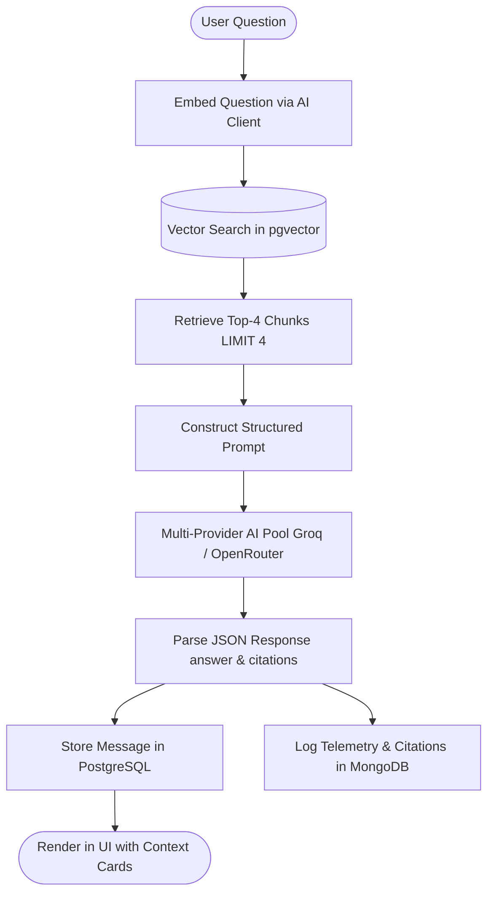

# AI Architecture & Development (AAD)

This document details the Artificial Intelligence, Retrieval-Augmented Generation (RAG) pipeline, and telemetry tracking architecture of rag99.

## 1. RAG Pipeline Overview

The system uses a custom-built, multi-stage Retrieval-Augmented Generation pipeline combining PostgreSQL vector search with MongoDB telemetry logging.



## 2. Document Ingestion Pipeline

When a user uploads a document, the system processes it as follows:
1. **Upload:** File is saved to Cloudinary (supporting raw and document mime types).
2. **Text Extraction:** Ingested buffer is converted to plain text via `pdf-parse`, `mammoth`, or UTF-8 decoding.
3. **Chunking:** Text is split using a sliding window algorithm (2000 characters chunk size, 200 character overlap).
4. **Embedding:** Each chunk is converted to a 1024-dimensional dense vector using `text-embedding-3-small`.
5. **Storage:** Stored in the `DocumentChunk` table with `::vector` casting in PostgreSQL.
6. **State Transition:** Status updates from `PROCESSING` to `READY` (or `FAILED` with `errorMessage` on failure).

## 3. Document Parsing
Implemented in `api/src/documents/extract-text.ts`. Supported formats:
- **PDF:** Parsed using `pdf-parse`.
- **DOCX:** Parsed using `mammoth`.
- **TXT / MD:** Decoded directly as UTF-8 string.
- **Unsupported MIME Types:** Rejection with `AppError(415, "Unsupported file format")`.

## 4. Chunking Strategy
Implemented in `api/src/documents/chunk-text.ts`.
- **Size:** 2000 characters.
- **Overlap:** 200 characters.
- **Method:** Sliding window algorithm to prevent loss of semantic context across chunk edges.

## 5. Embedding Generation
- **Model:** OpenRouter (`openai/text-embedding-3-small`).
- **Dimensions:** 1024 dimensions.
- **Client:** `api/src/ai/client-pool.ts` using `embedRotated()`.

## 6. pgvector Vector Similarity Search
Implemented in `api/src/ai/retrieval.ts`.
- **Database:** PostgreSQL with `pgvector` extension.
- **Distance Metric:** Cosine distance operator (`<=>`).
- **Scoping:** Filtered strictly by `chatId`.
- **Query:**
```sql
SELECT dc.content, d."originalName", dc."chunkIndex", dc.embedding <=> $1::vector AS distance 
FROM "DocumentChunk" dc 
JOIN "Document" d ON d.id = dc."documentId" 
WHERE dc."chatId" = $2 AND dc.embedding IS NOT NULL 
ORDER BY dc.embedding <=> $1::vector 
LIMIT $3
```

## 7. Prompt Engineering & Citation Enforcement
Implemented in `api/src/ai/prompt-builder.ts`.
- System prompts enforce strict grounding in provided evidence chunks.
- Output format enforced via `{ response_format: { type: "json_object" } }`.
- Expected JSON schema:
```json
{
  "answer": "string response based strictly on evidence",
  "citations": [
    { "source": "Document.pdf", "chunk": 0, "content": "relevant excerpt" }
  ]
}
```
- **Modes:**
  - `concise`: Maximum 3 sentences for rapid scanning.
  - `explain`: Structured deep-dive explanation.

## 8. Multi-Provider AI Pool & Fault Tolerance
Implemented in `api/src/ai/client-pool.ts`.
- **Providers:** Groq (`llama-3.3-70b-versatile`) and multiple OpenRouter keys (`meta-llama/llama-3.3-70b-instruct`).
- **Routing:** Round-robin selection across active keys.
- **Persistence:** State tracked in `.pool-index` and `.embed-index` to preserve rotation across restarts.
- **Failover:** Automatic failover to the next available provider upon receiving HTTP 429, 502, or 503 errors.

## 9. RAG Telemetry & Audit Logging (MongoDB)
Implemented in `api/src/db/mongo.ts` and `api/src/services/message.service.ts`.
Each question-answer cycle records an audit document in MongoDB capturing:
- `embedDurationMs`: Time spent generating vector embedding.
- `retrievalDurationMs`: Execution time of the `pgvector` cosine similarity query.
- `llmDurationMs`: Latency of the LLM generation.
- `totalLatencyMs`: End-to-end processing duration.
- `providerUsed`: Identifier of the pool provider that fulfilled the completion.
- `retrievedChunkCount`: Number of document chunks supplied as context.
- `rating`: Feedback state (`"up"`, `"down"`, or `""`).
- **Fail-safe Design:** If MongoDB is unreachable, the system logs a bypass notice and returns the answer to the user with zero interruption.


## 10. AI App Engineering: Function Calling & Tool Use

Implemented in `api/src/ai/tools.ts`.
- Declares structured tool specifications compatible with OpenAI/Groq function calling:
  - `query_document_chunks`: Vector similarity lookup with `query` and `topK` arguments.
  - `calculate_reading_time`: Text processing utility estimating reading duration.
- Dispatches tool executions dynamically via `executeTool(name, args)`.

## 11. Prompt Injection Defenses & Input Sanitization

Implemented in `api/src/middleware/sanitization.ts` and `api/src/routes/chat.routes.ts`.
- **Evasion Detection:** Checks incoming queries against jailbreak signatures (`ignore previous instructions`, `system override`, `dan mode`).
- **Delimiter Sanitization:** Strips LLM delimiter tokens (`<|im_start|>`, `### System:`) to prevent prompt boundary escaping.

## 12. Redis Caching for AI Query Optimization

Implemented in `api/src/db/cache.ts`.
- Caches generated embeddings and nearest-neighbor retrieval lookups with TTL expiration to eliminate redundant vector compute.