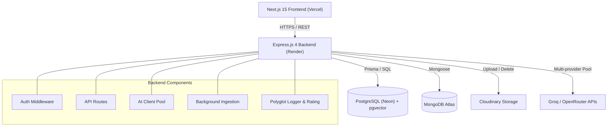
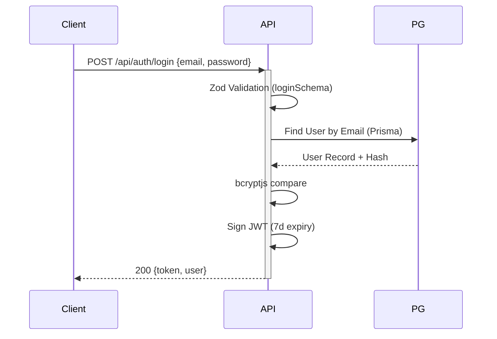
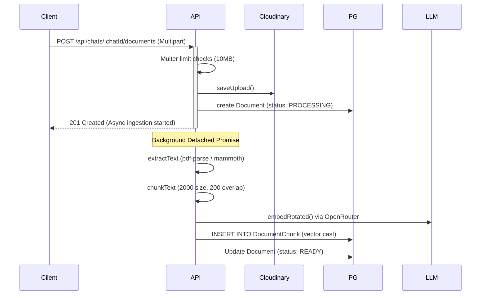
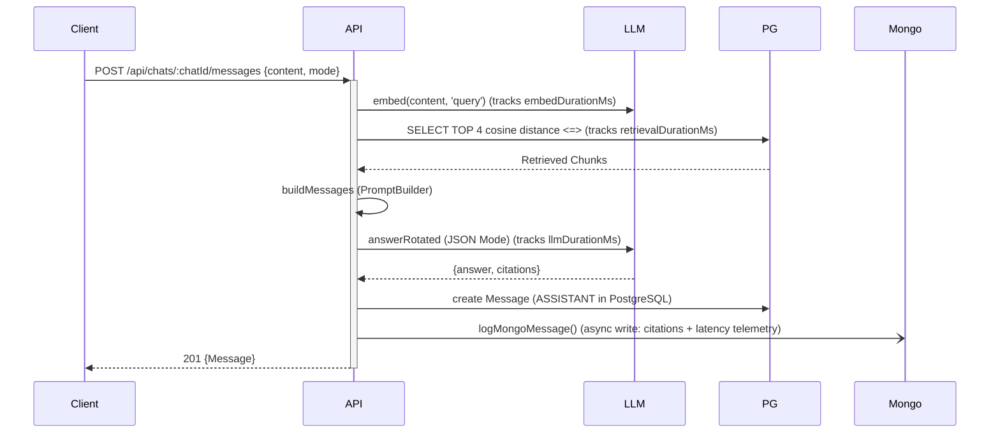
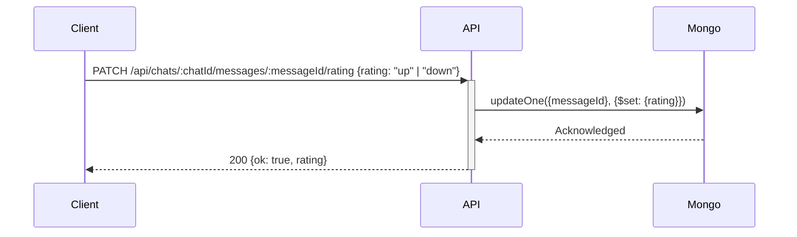
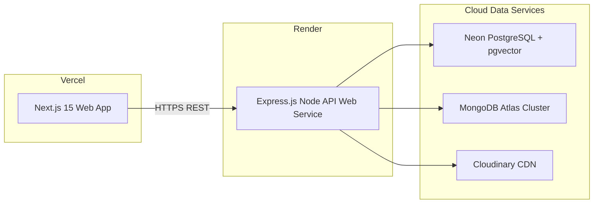

# High-Level Design (HLD)

## 1. Architecture Overview
rag99 is built on a modern full-stack architecture comprising a Next.js 15 App Router frontend (deployed on **Vercel**) and an Express.js 4 backend (deployed on **Render**). 

The system implements a **Polyglot Persistence Architecture**:
1. **Relational & Vector Store (PostgreSQL + pgvector via Prisma):** Enforces relational integrity, cascading constraints, and exact cosine distance (`<=>`) vector similarity search for document embeddings.
2. **Document & Telemetry Store (MongoDB Atlas via Mongoose):** Accommodates semi-structured conversational turns, embedded citations, user feedback ratings (thumbs up/down), and RAG execution telemetry (latency breakdown across embedding, retrieval, and LLM stages).

The system implements clear architectural separation for AI operations:
- **LLM Chat Completions:** Multi-provider round-robin rotation across Groq (llama-3.3-70b-versatile) and multiple OpenRouter keys (meta-llama/llama-3.3-70b-instruct) for fault tolerance.
- **Vector Embeddings:** Uses a single standardized embedding model (text-embedding-3-small, 1024 dimensions) routed through OpenRouter key rotation to guarantee mathematical compatibility between document chunk embeddings and query vectors (never mixing different embedding models).
- **Document Storage Clarification:** All document files, parsed text, and vector chunks are stored EXCLUSIVELY in PostgreSQL (Document and DocumentChunk models). MongoDB is NOT used for document storage; it solely records conversational telemetry, embedded citations, and user feedback ratings.

## 2. System Architecture Diagram



## 3. Component Diagram

```mermaid
graph TD
    subgraph Frontend (Next.js - Vercel)
        Context[ChatContext]
        UI[shadcn/ui + Tailwind]
        ClientAPI[web/lib/api.ts]
    end
    
    subgraph Backend (Express.js - Render)
        AuthService[auth.service.ts]
        ChatRoutes[chat.routes.ts]
        MessageService[message.service.ts]
        PromptBuilder[prompt-builder.ts]
        AIPool[client-pool.ts]
        MongoModel[mongo.ts ChatMessageDoc]
    end
    
    UI --> Context
    Context --> ClientAPI
    ClientAPI --> ChatRoutes
    ChatRoutes --> AuthService
    ChatRoutes --> MessageService
    MessageService --> PromptBuilder
    PromptBuilder --> AIPool
    MessageService --> MongoModel
```

## 4. System Components
- **Frontend (WHAT):** Next.js 15 React application. **(WHERE):** `web/` directory. **(HOW):** Uses Context API (`ChatContext`) for state, Tailwind/shadcn for UI. **(WHY):** Provides a modern, responsive user experience. Deployed on Vercel.
- **Backend API (WHAT):** Node.js Express 4 server. **(WHERE):** `api/src/`. **(HOW):** REST endpoints validated by Zod, modular routing and controllers. **(WHY):** Robust routing, middleware support, and background job handling. Deployed on Render.
- **Relational & Vector DB (WHAT):** PostgreSQL with Neon serverless and pgvector. **(WHERE):** Connected via Prisma ORM. **(HOW):** Stores relational data (Users, Chats, Messages, Documents) and 1024-dim embeddings in `DocumentChunk`. **(WHY):** Unified relational integrity with native vector search.
- **Document & Telemetry DB (WHAT):** MongoDB Atlas. **(WHERE):** `api/src/db/mongo.ts`. **(HOW):** Mongoose schema for chat messages, embedded citation arrays, ratings, and time-series latency telemetry. **(WHY):** Decouples write-heavy analytics and variable document schemas from transactional tables.
- **AI Pool (WHAT):** Multi-provider round-robin pool. **(WHERE):** `api/src/ai/client-pool.ts`. **(HOW):** Rotates through Groq and OpenRouter keys with disk-persisted pointer. **(WHY):** Prevents provider lock-in and avoids rate limit outages.

## 5. Request Flows

### Authentication Flow (Email/Password & Google OAuth)


### Document Upload & Ingestion Flow


### RAG Query & Polyglot Telemetry Flow


### User Feedback Flow (Thumbs Up / Down)


## 6. Polyglot Persistence Architecture Rationale

> **CRITICAL ARCHITECTURAL DISTINCTION:**
> - **Document Uploads & Chunks:** Handled **EXCLUSIVELY by PostgreSQL (`Document` and `DocumentChunk` models)** and Cloudinary. MongoDB is **NEVER** used to store uploaded document files, binary text, or chunk embeddings.
> - **MongoDB Role:** MongoDB Atlas is strictly used for **conversational message telemetry (`ChatMessageDoc`), embedded citations, user feedback ratings (thumbs up/down), and latency measurements**.


| Dimension | PostgreSQL + pgvector (Prisma) | MongoDB Atlas (Mongoose) |
|---|---|---|
| **Role** | Transactional core & Vector search | Telemetry, Audit log & User feedback |
| **Data Stored** | User accounts, Chat metadata, Documents, Document Chunks with 1024-dim vectors | Conversational message documents, embedded citation subdocuments, timing telemetry, ratings |
| **Guarantees** | Strict ACID, Referential Integrity (`ON DELETE CASCADE`) | High-throughput document writes, flexible schema evolution |
| **Resilience Strategy** | Primary dependency (database connection required) | Fail-safe bypass: if MongoDB is unreachable, RAG query processing completes normally without error |

## 7. AI Architecture
- **WHAT:** Intelligent text generation and semantic embedding.
- **WHERE:** `api/src/ai/client-pool.ts`, `api/src/ai/prompt-builder.ts`, `api/src/ai/retrieval.ts`.
- **HOW:** Uses `text-embedding-3-small` (1024 dims) for embeddings. Generates completions using JSON mode `{type:'json_object'}` via Groq (`llama-3.3-70b-versatile`) or OpenRouter (`meta-llama/llama-3.3-70b-instruct`).
- **WHY:** JSON mode guarantees parseable output for the `{answer, citations}` schema. Multi-provider rotation guarantees resilience.

## 8. Deployment Architecture



- **Frontend (Vercel):** Connected to GitHub repository. Root Directory set to `web`. Environment variable `NEXT_PUBLIC_API_URL` points to the live Render backend URL.
- **Backend (Render):** Deployed as a Web Service. Render natively supports both native Node.js environments and containerized Docker deployments using `api/Dockerfile`. In `api/Dockerfile`, `EXPOSE 4000` serves as internal container port documentation, and `CMD ["node", "dist/server.js"]` specifies the runtime entrypoint. In Render deployments, Render dynamically assigns a host port via `process.env.PORT` which `api/src/config.ts` binds to dynamically, routing public HTTPS traffic into the container.
- **CORS Handling:** Configured dynamically to accept requests from localhost during development and production `.vercel.app` domains.

## 9. Major Design Decisions

| Decision | Alternatives Considered | Trade-off / Rationale |
|----------|-------------------------|------------------------|
| **Polyglot Persistence** | Monolithic PostgreSQL only | **PRO:** Offloads chat telemetry and unindexed citation JSON from PG; gives rich document storage for ratings. **CON:** Requires managing two database connection strings. |
| **PostgreSQL + pgvector** | Pinecone, Milvus | **PRO:** Atomic joins between chunks, documents, and chats. Zero data synchronization delays. **CON:** Requires explicit vector index tuning at huge scale. |
| **Multi-Provider Pool** | Single OpenAI API | **PRO:** Zero downtime during provider outages or rate limits. **CON:** Minor logic overhead managing round-robin pointer. |
| **Fail-Safe Mongo Bypass** | Hard dependency on MongoDB | **PRO:** If Atlas has DNS/network blip, core chat and RAG flow continue uninterrupted. **CON:** Telemetry is skipped during outage window. |


## 10. Advanced Architecture Concepts Implemented

### 10.1 NoSQL MongoDB: Embedding vs Referencing Relationships
- **File:** `api/src/db/mongo.ts`
- **Embedding:** Citations (`CitationSubSchema`) and execution latency metrics (`RagTelemetrySubSchema`) are embedded directly inside `ChatMessageDocSchema` as subdocuments for fast single-turn reads.
- **Referencing:** `MongoChatSession` implements normalized document referencing with `lastMessageRef: { type: Schema.Types.ObjectId, ref: "ChatMessage" }` and `pinnedMessages`, dynamically populated with Mongoose `.populate()`.

### 10.2 NoSQL MongoDB: Aggregation Pipelines
- **File:** `api/src/db/mongo.ts`, `api/src/routes/chat.routes.ts`
- **Implementation:** `getChatAnalyticsPipeline(chatId)` runs a 4-stage aggregation pipeline:
  1. `$match`: Filters records by `chatId` and `ASSISTANT` role.
  2. `$group`: Aggregates latency statistics (`avgEmbedDurationMs`, `avgRetrievalDurationMs`, `avgLlmDurationMs`, `avgTotalLatencyMs`) and sums user ratings (upvotes/downvotes).
  3. `$project`: Reshapes document metrics and rounds numerical averages via `$round`.
  4. `$sort`: Orders results by response count.
- **Route:** Exposed via `GET /api/chats/:chatId/analytics`.

### 10.3 SQL PostgreSQL: ACID Transactions
- **File:** `api/src/services/chat.service.ts`
- **Implementation:** `deleteChat(userId, id)` wraps cascading deletions across `DocumentChunk`, `Document`, and `Message` inside `prisma.$transaction(async (tx) => { ... })` to guarantee atomicity and rollback safety.

### 10.4 Input Sanitization & Prompt Injection Awareness and Defenses
- **Files:** `api/src/middleware/sanitization.ts`, `api/src/routes/chat.routes.ts`
- **XSS Sanitization:** `sanitizeHtml()` neutralizes script and iframe injection payloads.
- **Prompt Injection Filter:** `sanitizePrompt()` detects adversarial jailbreak patterns (`ignore previous instructions`, `system override`, `dan mode`) and strips special delimiter tokens (`<|im_start|>`, `### System:`) before the query enters the RAG pipeline.

### 10.5 Caching with Redis & In-Memory Store
- **File:** `api/src/db/cache.ts`
- **Implementation:** `RedisCacheManager` uses `ioredis` with TTL expiration and an automatic in-memory fallback store to cache query embeddings and frequent chunk queries.

### 10.6 Scheduled Jobs & Cron Runner
- **File:** `api/src/jobs/cron.ts`
- **Implementation:** `setupScheduledJobs()` uses `node-cron` to run recurring background tasks: hourly cache and temporary storage pruning, and daily midnight telemetry archiving.

### 10.7 WebSocket / Real-Time Communication
- **File:** `api/src/server.ts`
- **Implementation:** `WebSocketServer` (from `ws`) attached to the HTTP server on path `/ws` enabling bidirectional client communication for live progress events.

### 10.8 Containerization with Docker
- **Files:** `api/Dockerfile`, `web/Dockerfile`, `docker-compose.yml`
- **Implementation:** Multi-stage Docker builds for Node.js API and Next.js frontend with unified Docker Compose orchestration.

### 10.9 Function Calling / Tool Use
- **File:** `api/src/ai/tools.ts`
- **Implementation:** Declares structured tool schemas (`query_document_chunks`, `calculate_reading_time`) and dynamic execution dispatch for AI agent integrations.

### 10.10 JavaScript — Event loop
- **Files:** `api/src/services/auth.service.ts`, `api/src/routes/auth.routes.ts`, `web/components/ThinkingState.tsx`
- **Implementation:** The single-threaded V8 engine handles synchronous checks and JWT signing on the Call Stack. Heavy I/O (PostgreSQL TCP queries via Prisma) and CPU-bound operations (`bcrypt.hash` 12 salt rounds) are offloaded to Libuv and its worker thread pool, resolving asynchronously via the Microtask Queue before Macrotask timers (`setTimeout`).

### 10.11 JavaScript — Hoisting
- **Files:** `web/components/ThinkingState.tsx`, `api/src/services/auth.service.ts`
- **Implementation:** Contrasts compilation phase declarations. `const STAGES` is placed in the Temporal Dead Zone (TDZ), throwing a `ReferenceError` if accessed prematurely, while `function useSequence` is hoisted with its definition. In the backend, block-scoped `let user` avoids the scope leakage and variable shadowing vulnerabilities of legacy `var`.

### 10.12 Server-side rendering
- **Category:** System & Integration
- **Files:** `web/app/layout.tsx`, `web/app/page.tsx`
- **Implementation:** Next.js React Server Components (RSC) rendered dynamically on the server for each incoming HTTP request (`force-dynamic`). Delivers the full HTML document directly to the client for immediate SEO, fast First Contentful Paint (FCP), and zero initial client-side bundle execution.

### 10.13 Environment variables & secrets management
- **Category:** Engineering Practices
- **Files:** `api/src/config.ts`, `api/.env.example`, `.env.example`
- **Implementation:** Enforces boot-time schema validation with Zod (`envSchema`). Guarantees fail-fast crash if required database URLs or secrets (`JWT_SECRET` >= 32 chars) are missing or insecure, preventing secret leakage or runtime misconfiguration.
