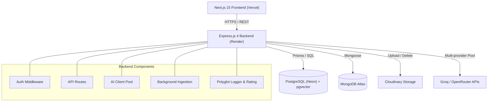
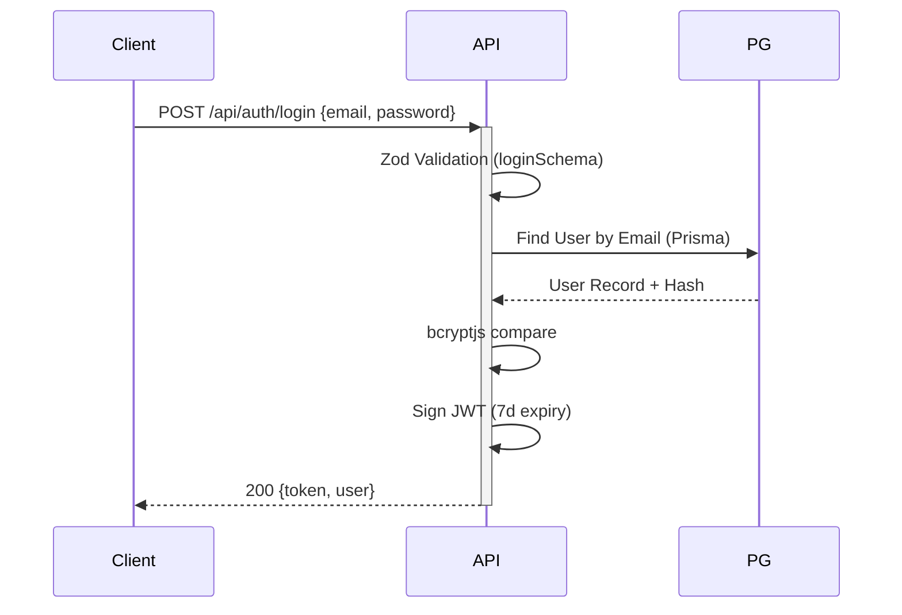
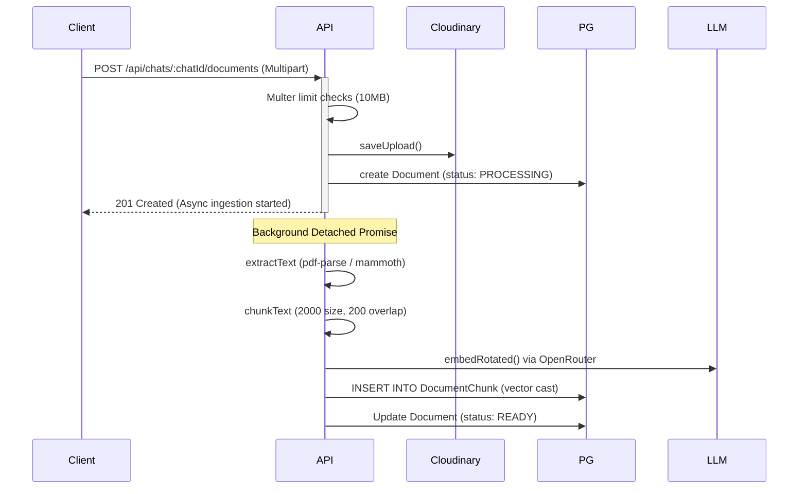
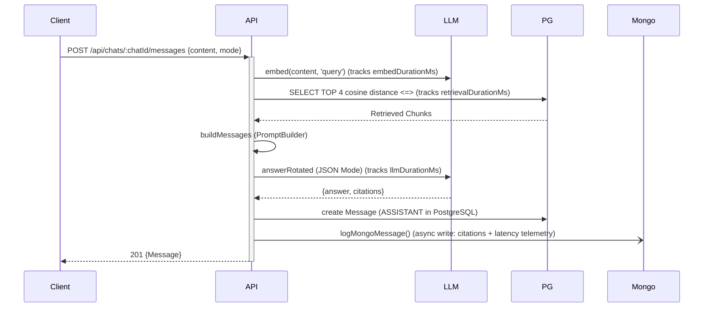
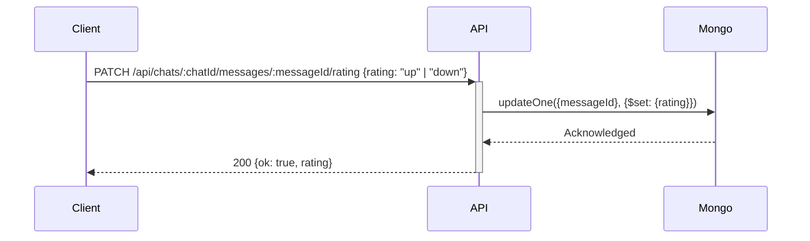
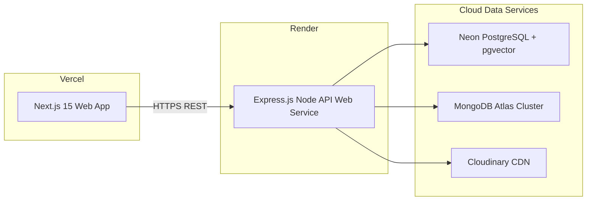

# High-Level Design (HLD)

## 1. Architecture Overview
rag99 is built on a modern full-stack architecture comprising a Next.js 15 App Router frontend (deployed on **Vercel**) and an Express.js 4 backend (deployed on **Render**). 

The system implements a **Polyglot Persistence Architecture**:
1. **Relational & Vector Store (PostgreSQL + pgvector via Prisma):** Enforces relational integrity, cascading constraints, and exact cosine distance (`<=>`) vector similarity search for document embeddings.
2. **Document & Telemetry Store (MongoDB Atlas via Mongoose):** Accommodates semi-structured conversational turns, embedded citations, user feedback ratings (thumbs up/down), and RAG execution telemetry (latency breakdown across embedding, retrieval, and LLM stages).

The backend uses a multi-provider AI client pool to rotate between Groq and OpenRouter keys to guarantee high availability.

## 2. System Architecture Diagram



## 3. Component Diagram

```mermaid
graph TD
    subgraph Frontend (Next.js - Vercel)
        Context[ChatContext]
        UI[shadcn/ui + Tailwind]
        ClientAPI[web/lib/api.ts]
    end
    
    subgraph Backend (Express.js - Render)
        AuthService[auth.service.ts]
        ChatRoutes[chat.routes.ts]
        MessageService[message.service.ts]
        PromptBuilder[prompt-builder.ts]
        AIPool[client-pool.ts]
        MongoModel[mongo.ts ChatMessageDoc]
    end
    
    UI --> Context
    Context --> ClientAPI
    ClientAPI --> ChatRoutes
    ChatRoutes --> AuthService
    ChatRoutes --> MessageService
    MessageService --> PromptBuilder
    PromptBuilder --> AIPool
    MessageService --> MongoModel
```

## 4. System Components
- **Frontend (WHAT):** Next.js 15 React application. **(WHERE):** `web/` directory. **(HOW):** Uses Context API (`ChatContext`) for state, Tailwind/shadcn for UI. **(WHY):** Provides a modern, responsive user experience. Deployed on Vercel.
- **Backend API (WHAT):** Node.js Express 4 server. **(WHERE):** `api/src/`. **(HOW):** REST endpoints validated by Zod, modular routing and controllers. **(WHY):** Robust routing, middleware support, and background job handling. Deployed on Render.
- **Relational & Vector DB (WHAT):** PostgreSQL with Neon serverless and pgvector. **(WHERE):** Connected via Prisma ORM. **(HOW):** Stores relational data (Users, Chats, Messages, Documents) and 1024-dim embeddings in `DocumentChunk`. **(WHY):** Unified relational integrity with native vector search.
- **Document & Telemetry DB (WHAT):** MongoDB Atlas. **(WHERE):** `api/src/db/mongo.ts`. **(HOW):** Mongoose schema for chat messages, embedded citation arrays, ratings, and time-series latency telemetry. **(WHY):** Decouples write-heavy analytics and variable document schemas from transactional tables.
- **AI Pool (WHAT):** Multi-provider round-robin pool. **(WHERE):** `api/src/ai/client-pool.ts`. **(HOW):** Rotates through Groq and OpenRouter keys with disk-persisted pointer. **(WHY):** Prevents provider lock-in and avoids rate limit outages.

## 5. Request Flows

### Authentication Flow (Email/Password & Google OAuth)


### Document Upload & Ingestion Flow


### RAG Query & Polyglot Telemetry Flow


### User Feedback Flow (Thumbs Up / Down)


## 6. Polyglot Persistence Architecture Rationale

| Dimension | PostgreSQL + pgvector (Prisma) | MongoDB Atlas (Mongoose) |
|---|---|---|
| **Role** | Transactional core & Vector search | Telemetry, Audit log & User feedback |
| **Data Stored** | User accounts, Chat metadata, Documents, Document Chunks with 1024-dim vectors | Conversational message documents, embedded citation subdocuments, timing telemetry, ratings |
| **Guarantees** | Strict ACID, Referential Integrity (`ON DELETE CASCADE`) | High-throughput document writes, flexible schema evolution |
| **Resilience Strategy** | Primary dependency (database connection required) | Fail-safe bypass: if MongoDB is unreachable, RAG query processing completes normally without error |

## 7. AI Architecture
- **WHAT:** Intelligent text generation and semantic embedding.
- **WHERE:** `api/src/ai/client-pool.ts`, `api/src/ai/prompt-builder.ts`, `api/src/ai/retrieval.ts`.
- **HOW:** Uses `text-embedding-3-small` (1024 dims) for embeddings. Generates completions using JSON mode `{type:'json_object'}` via Groq (`llama-3.3-70b-versatile`) or OpenRouter (`meta-llama/llama-3.3-70b-instruct`).
- **WHY:** JSON mode guarantees parseable output for the `{answer, citations}` schema. Multi-provider rotation guarantees resilience.

## 8. Deployment Architecture



- **Frontend (Vercel):** Connected to GitHub repository. Root Directory set to `web`. Environment variable `NEXT_PUBLIC_API_URL` points to the live Render backend URL.
- **Backend (Render):** Deployed as a Web Service. Root Directory: `api` (or monorepo root with `npm run build:api`). Start command: `node dist/server.js`. Managed environment variables for database URLs, AI keys, and CORS.
- **CORS Handling:** Configured dynamically to accept requests from localhost during development and production `.vercel.app` domains.

## 9. Major Design Decisions

| Decision | Alternatives Considered | Trade-off / Rationale |
|----------|-------------------------|------------------------|
| **Polyglot Persistence** | Monolithic PostgreSQL only | **PRO:** Offloads chat telemetry and unindexed citation JSON from PG; gives rich document storage for ratings. **CON:** Requires managing two database connection strings. |
| **PostgreSQL + pgvector** | Pinecone, Milvus | **PRO:** Atomic joins between chunks, documents, and chats. Zero data synchronization delays. **CON:** Requires explicit vector index tuning at huge scale. |
| **Multi-Provider Pool** | Single OpenAI API | **PRO:** Zero downtime during provider outages or rate limits. **CON:** Minor logic overhead managing round-robin pointer. |
| **Fail-Safe Mongo Bypass** | Hard dependency on MongoDB | **PRO:** If Atlas has DNS/network blip, core chat and RAG flow continue uninterrupted. **CON:** Telemetry is skipped during outage window. |
